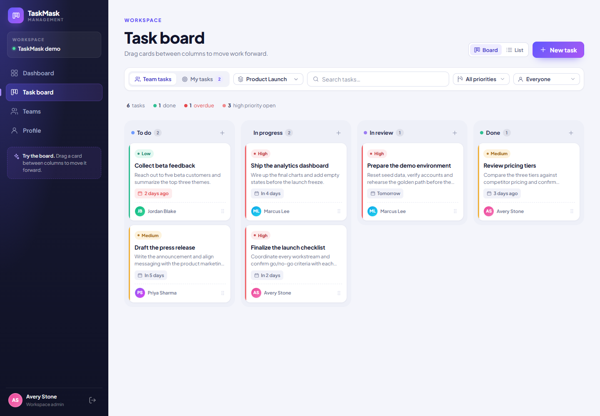
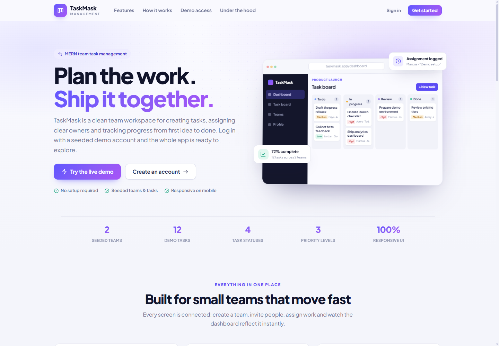
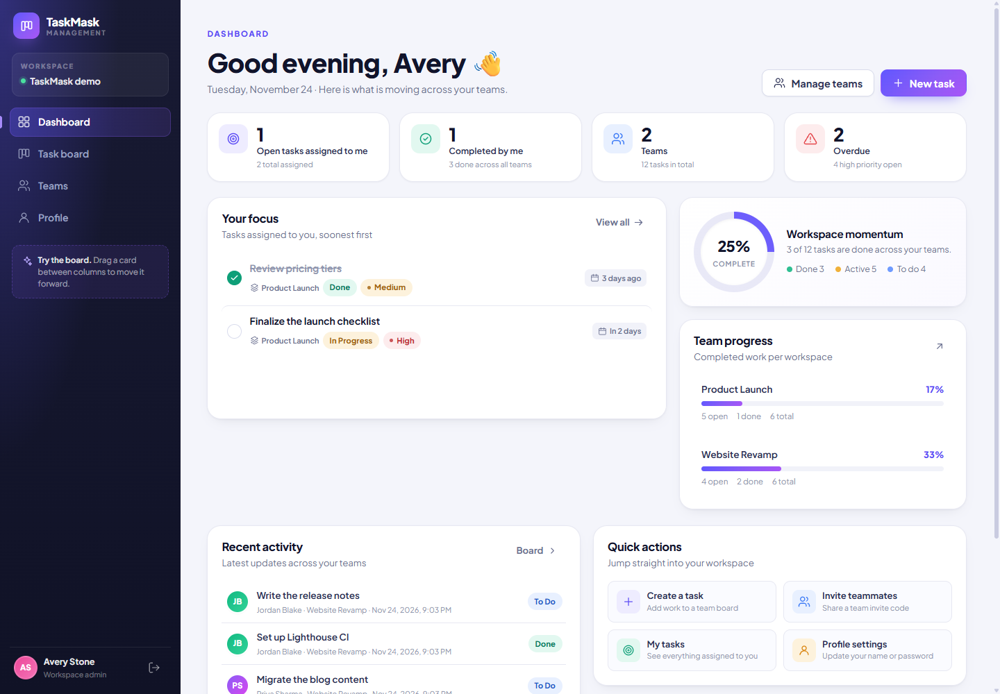
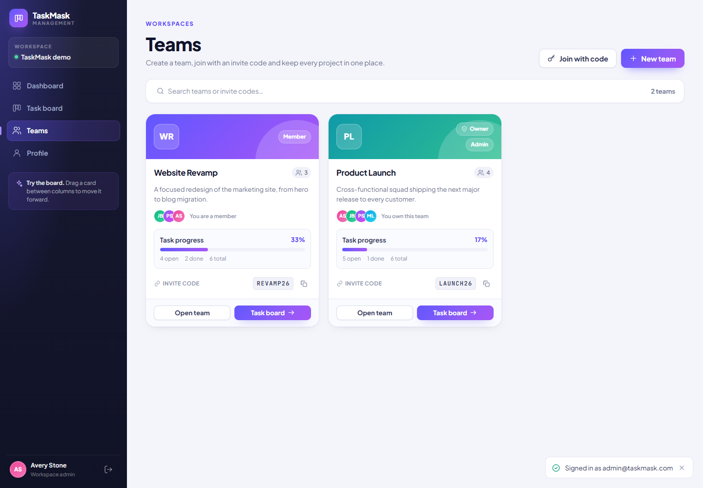
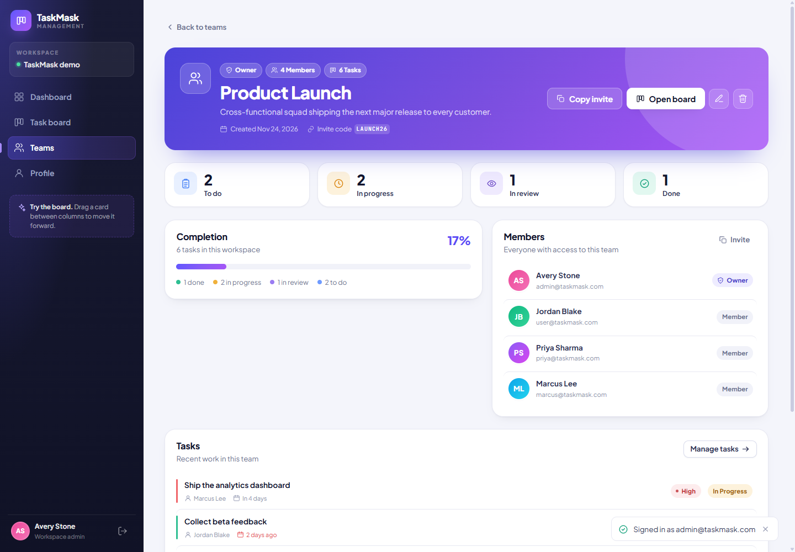
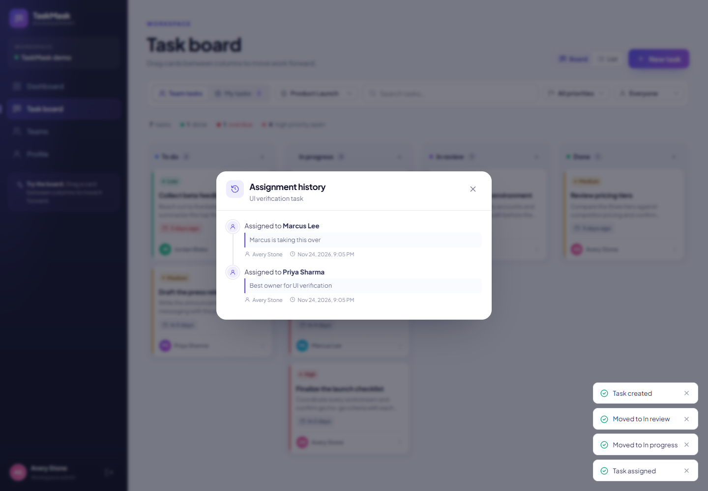
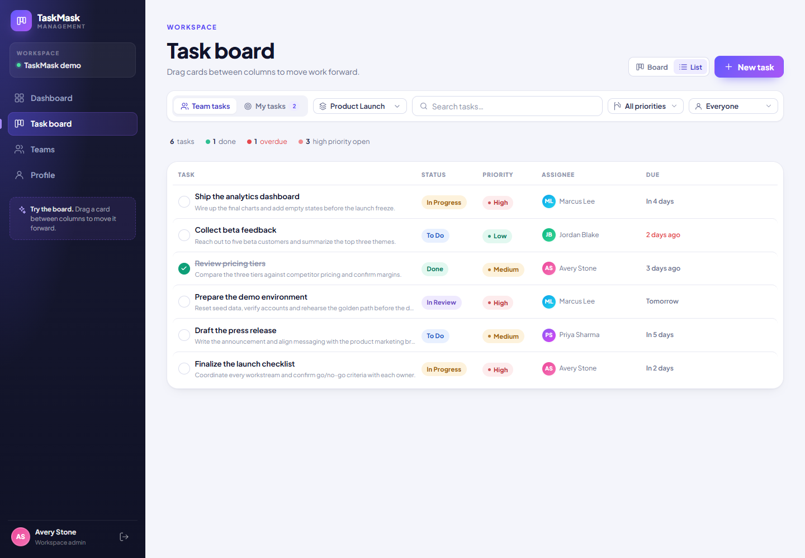
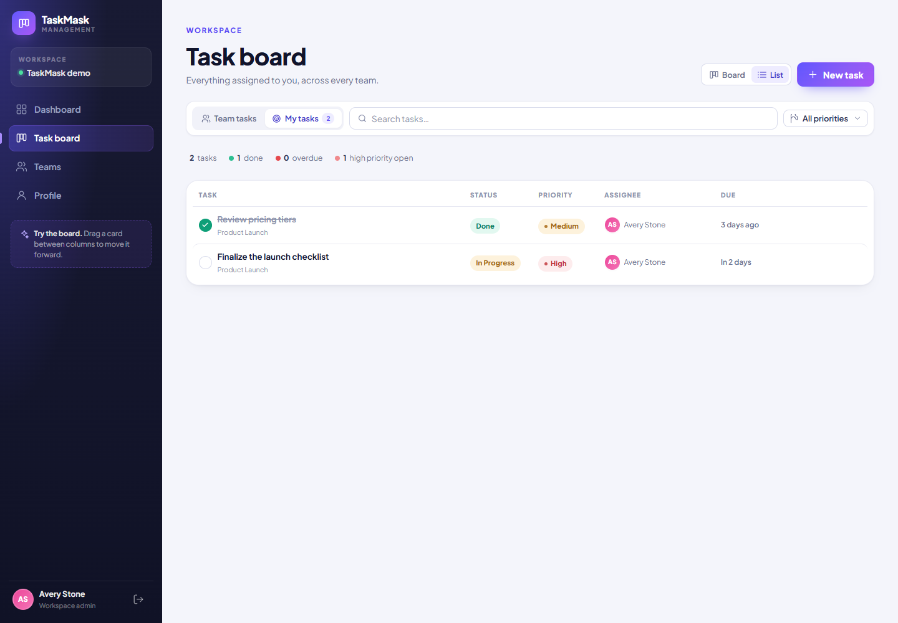
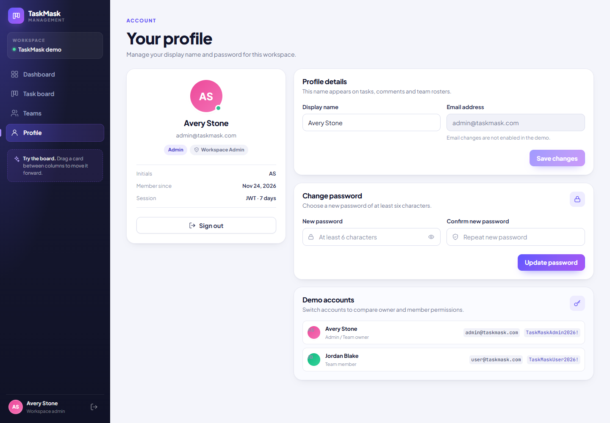
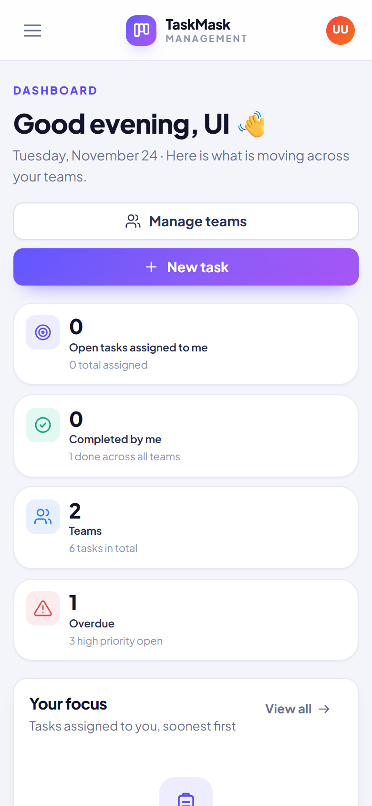

# TaskMask Management

A complete team task-management workspace built with the **MERN stack** — MongoDB, Express, React and Node.js. Teams create workspaces, plan work on a Kanban board, assign clear owners with a written reason, and follow progress on a live dashboard.



## Verified working

The application was tested end-to-end on **24 November 2026** against a fresh, auto-seeded database.

| Check | Result |
| --- | --- |
| API verification (auth, teams, tasks, permissions, validation) | **61 / 61 passed** |
| Browser verification in headless Chrome (desktop + mobile) | **71 / 71 passed** |
| Production frontend build (`npm run build`) | **Passed** — 120 modules, 333.75 kB JS / 72.72 kB CSS |
| Production server mode (`NODE_ENV=production`) | **Passed** — `/`, `/dashboard` and `/api/health` return 200 |

Environment used: Windows, Node.js **v25.2.1**, npm **10.9.11**, MongoDB running locally, Chrome 158.

What was exercised:

- Demo and manual login, registration, logout, protected and public routes
- JWT authorization and rejection of missing/invalid tokens
- Team creation, invite-code joining, owner-only rename/delete, cascade task deletion
- Task creation, editing, deletion, status changes, priorities, due dates
- Kanban **drag and drop** plus the touch-friendly status dropdown fallback
- Assignment and unassignment with a reason, and the full assignment-history timeline
- Dashboard stats, per-team progress, focus list and recent activity
- Search, status/priority/assignee filters, pagination, board and list views
- Profile name and password updates
- Responsive layout at 1440 px and 390 px, including the mobile sidebar
- 404 handling, empty states, error handling and console/network health

### Fixes applied during verification

- Mongoose validation errors, malformed ObjectIds and duplicate-key errors now return clean `400` JSON responses instead of `500`.
- Task creation now validates the title and team explicitly.
- The assignment reason entered when creating a task is now stored on the initial history entry (previously it was replaced with a generic label).

## Demo logins

The first time the server starts against an empty database it seeds four users, two teams and twelve tasks. The welcome page lists the same accounts.

| Role | Name | Email | Password |
| --- | --- | --- | --- |
| Admin / team owner | Avery Stone | `admin@taskmask.com` | `TaskMaskAdmin2026!` |
| Team member / owner | Jordan Blake | `user@taskmask.com` | `TaskMaskUser2026!` |
| Teammate | Priya Sharma | `priya@taskmask.com` | `TaskMask2026!` |
| Teammate | Marcus Lee | `marcus@taskmask.com` | `TaskMask2026!` |

Seeded teams:

| Team | Invite code | Owner |
| --- | --- | --- |
| Product Launch | `LAUNCH26` | Avery Stone |
| Website Revamp | `REVAMP26` | Jordan Blake |

> Seeding is idempotent. Running it again adds only missing demo records; it never duplicates existing ones.

## Screenshots

| Welcome | Dashboard |
| --- | --- |
|  |  |

| Teams | Team detail |
| --- | --- |
|  |  |

| Task board | Assignment history |
| --- | --- |
|  |  |

| List view | My tasks |
| --- | --- |
|  |  |

| Profile | Mobile dashboard |
| --- | --- |
|  |  |

## Features

- **Marketing welcome page** with feature tour, four-step walkthrough, demo credentials and one-click demo sign-in.
- **Authentication** — register, login, JWT sessions, persisted auth state, protected routes and automatic sign-out on `401`.
- **Team workspaces** — create a team, join with a six-character invite code, view members and roles, owner-only editing and deletion. Deleting a team also deletes its tasks.
- **Kanban task board** — four columns (To do, In progress, In review, Done), drag and drop on desktop, a status dropdown on touch devices, per-column counts and quick add.
- **Task management** — title, description, status, priority (low/medium/high), due date and assignee. Search, priority/assignee filters, board and list views.
- **Assignment trail** — assign or unassign with a reason; every change is stored with the actor, reason and timestamp in a history timeline.
- **Live dashboard** — open work, completed work, team count, overdue items, completion ring, per-team progress, personal focus list and recent activity.
- **Personal views** — “My tasks” across every team, plus a dashboard focus list.
- **Profile** — update display name, change password, view seeded demo accounts and sign out.
- **Responsive UI** — collapsible sidebar on tablet/mobile, adaptive board, modal dialogs, toasts, skeleton loaders and empty states.
- **Demo data** — automatic seeding on first start against an empty database, plus an idempotent `npm run seed` CLI.
- **Resilient API** — JSON errors everywhere; model validation and malformed IDs return clean `400` responses instead of server errors.

## Tech stack

| Layer | Technology |
| --- | --- |
| Frontend | React 18, Vite 5, React Router 6, Axios |
| Backend | Node.js, Express 4, express-async-handler |
| Database | MongoDB with Mongoose 8 |
| Auth | JSON Web Tokens, bcryptjs password hashing |
| Styling | Hand-written CSS with design tokens (no UI framework) |

## Project structure

```text
TaskMaskManagement/
├── client/                        # React frontend (Vite)
│   ├── src/
│   │   ├── components/            # AppLayout, PublicLayout, AuthLayout, Modal, Toast,
│   │   │                          # Icon, Avatar, Badge, Loader, EmptyState, CopyButton…
│   │   ├── context/               # AuthContext (JWT state)
│   │   ├── pages/                 # Welcome, Login, Register, Dashboard, Teams,
│   │   │                          # TeamDetail, Tasks, Profile, NotFound
│   │   ├── services/              # Axios client with auth + 401 handling
│   │   ├── styles/                # base, marketing, app and task board CSS
│   │   ├── utils/                 # Formatting helpers and demo credentials
│   │   ├── App.jsx
│   │   └── index.css
│   ├── index.html
│   └── vite.config.js             # Dev server on :3000, proxies /api to :4000
├── server/                        # Express API
│   ├── config/db.js               # MongoDB connection
│   ├── controllers/               # Auth, Team and Task controllers
│   ├── middleware/auth.js         # JWT protect middleware
│   ├── models/                    # User, Team and Task models
│   ├── routes/                    # Auth, Team and Task routes
│   ├── seeders/                   # Demo seed data + CLI
│   ├── utils/generateToken.js     # JWT signing
│   ├── .env                       # Local environment (not committed)
│   ├── server.js                  # Entry point + error handler + prod static serving
│   └── package.json
├── docs/screenshots/              # Screenshots used in this README
└── README.md
```

## Prerequisites

- **Node.js** 16 or newer (verified on Node 25)
- **npm**
- **MongoDB** running locally on `mongodb://localhost:27017`, or a MongoDB Atlas connection string
- A modern browser

## Getting started

### 1. Backend

```bash
cd server
npm install
npm run dev
```

The API starts on **http://localhost:4000**. Use `npm start` instead of `npm run dev` if you do not want nodemon.

Create `server/.env` if it does not exist:

```env
PORT=4000
MONGO_URI=mongodb://localhost:27017/taskmaskmanagement
JWT_SECRET=change_me_in_production
JWT_EXPIRE=7d
```

| Variable | Purpose |
| --- | --- |
| `PORT` | API port. Defaults to `5000` if unset, but the client proxy expects `4000`. |
| `MONGO_URI` | MongoDB connection string. |
| `JWT_SECRET` | Signing secret — replace it outside local development. |
| `JWT_EXPIRE` | Token lifetime (for example `7d`). |
| `NODE_ENV` | Set to `production` to serve the built client from Express. |

On startup against an empty database, demo users, teams and tasks are created automatically. You will see the seeded credentials in the console.

### 2. Frontend

In a second terminal:

```bash
cd client
npm install
npm run dev
```

Open **http://localhost:3000**. Vite proxies `/api` requests to `http://localhost:4000`.

### 3. Use the app

1. Open `http://localhost:3000` and click **Try the live demo**, or sign in manually with a demo account.
2. Open **Teams** to see Product Launch and Website Revamp, their members and invite codes.
3. Open **Task board**, create a task, set priority and due date, then drag it between columns (or use the status dropdown).
4. Use the assign action to set an owner with a reason, then open **Assignment history** to see every change.
5. Create a team or join one with a code such as `LAUNCH26` / `REVAMP26`.
6. Follow completion and overdue counts on the **Dashboard**, and update your name or password in **Profile**.

## Production build

Build the React app:

```bash
cd client
npm run build          # outputs client/dist
```

Run the API in production mode so Express also serves the built frontend:

```bash
cd server
NODE_ENV=production npm start     # macOS / Linux
```

PowerShell:

```powershell
$env:NODE_ENV="production"
npm start
```

Then open **http://localhost:4000**. Deep links such as `/dashboard` are handled by the SPA fallback, and `/api/*` continues to serve the JSON API.

## Demo data

```bash
cd server
npm run seed
```

The CLI connects to `MONGO_URI`, ensures the four demo users and two teams exist, and creates any missing demo tasks. It is safe to run repeatedly.

To start completely fresh, drop the `taskmaskmanagement` database in your MongoDB client (or `mongosh`), then run `npm run seed` or simply restart the server:

```bash
mongosh mongodb://localhost:27017/taskmaskmanagement --eval "db.dropDatabase()"
cd server && npm run seed
```

> Dropping the database deletes all users, teams and tasks, not just demo data.

## API reference

Base URL: `http://localhost:4000/api`. Protected routes expect `Authorization: Bearer <token>`.

### Auth

| Method | Endpoint | Description |
| --- | --- | --- |
| `POST` | `/auth/register` | Create an account and return a JWT |
| `POST` | `/auth/login` | Sign in and return a JWT |
| `GET` | `/auth/me` | Current user profile |
| `PUT` | `/auth/me` | Update display name and/or password |
| `GET` | `/health` | Health check |

### Teams

| Method | Endpoint | Description |
| --- | --- | --- |
| `GET` | `/teams` | Teams the current user belongs to (populated members) |
| `POST` | `/teams` | Create a team; generates an invite code |
| `GET` | `/teams/:id` | Team details (members only) |
| `POST` | `/teams/join` | Join by invite code (case-insensitive) |
| `PUT` | `/teams/:id` | Rename/update (owner only) |
| `DELETE` | `/teams/:id` | Delete team and its tasks (owner only) |

### Tasks

| Method | Endpoint | Description |
| --- | --- | --- |
| `GET` | `/tasks?team=:teamId` | Team tasks; supports `status`, `priority`, `assignedTo`, `page`, `limit` |
| `GET` | `/tasks/my-tasks` | Tasks assigned to the current user |
| `GET` | `/tasks/stats` | Dashboard aggregates, per-team progress, focus list, recent activity |
| `POST` | `/tasks` | Create a task (optional initial assignee and reason) |
| `PUT` | `/tasks/:id` | Update title, description, status, priority or due date |
| `DELETE` | `/tasks/:id` | Delete (task creator, team admin or team owner) |
| `PATCH` | `/tasks/:id/assign` | Assign to a team member with a reason |
| `PATCH` | `/tasks/:id/unassign` | Remove the assignee with a reason |
| `GET` | `/tasks/:id/assignment-history` | Assignment timeline |

Example:

```bash
# Login and capture the token
curl -X POST http://localhost:4000/api/auth/login \
  -H "Content-Type: application/json" \
  -d '{"email":"admin@taskmask.com","password":"TaskMaskAdmin2026!"}'

# List your teams
curl http://localhost:4000/api/teams -H "Authorization: Bearer <token>"
```

## Roles and permissions

| Action | Team owner | Team admin | Team member |
| --- | --- | --- | --- |
| View team and its tasks | Yes | Yes | Yes |
| Create and edit tasks | Yes | Yes | Yes |
| Change task status | Yes | Yes | Yes |
| Assign / unassign with reason | Yes | Yes | Yes |
| Delete someone else’s task | Yes | Yes (team role admin) | No |
| Rename or delete the team | Yes (owner only) | No | No |
| Join another team by code | Yes | Yes | Yes |

An assignee must always be a member of the task’s team. API requests from non-members are rejected with `403`.

## Data model

- **User** — name, unique lowercase email, bcrypt-hashed password, role (`user` / `admin`), timestamps.
- **Team** — name, description, owner, members (`user` + `admin`/`member` role + joined date), unique invite code, timestamps.
- **Task** — title, description, status (`todo`, `in-progress`, `review`, `done`), priority (`low`, `medium`, `high`), team, assignee, creator, due date, assignment history (assignee, actor, timestamp, reason), timestamps.

Indexes cover `team + status`, `assignedTo` and `createdBy` for fast board and “my tasks” queries.

## Scripts

| Location | Command | What it does |
| --- | --- | --- |
| `server` | `npm start` | Start the API |
| `server` | `npm run dev` | Start the API with nodemon |
| `server` | `npm run seed` | Seed or top up demo data |
| `client` | `npm run dev` | Start the Vite dev server on port 3000 |
| `client` | `npm run build` | Build the production bundle into `client/dist` |
| `client` | `npm run preview` | Preview the production build |

## Troubleshooting

| Symptom | Fix |
| --- | --- |
| `MongoDB Connected` never appears / connection error | Make sure MongoDB is running and `MONGO_URI` is correct. The server exits if it cannot connect. |
| Login works in the API but not the UI | Confirm the API is on port **4000** and the Vite proxy in `client/vite.config.js` still targets it. |
| “Demo sign-in failed” on the welcome page | The database is empty or unreachable. Start the server (it auto-seeds) or run `cd server && npm run seed`. |
| `EADDRINUSE` on 3000 or 4000 | Stop the process using that port, or change the port. Update the Vite proxy if you move the API. |
| Instant redirect to `/login` after loading | The stored JWT is missing, invalid or expired. Sign in again; `401` responses clear the session automatically. |
| Tasks missing from a board | You only see tasks for teams you belong to. Join with an invite code or create your own team. |
| Demo data looks different after manual testing | `npm run seed` only adds missing demo records; it never deletes or resets your work. Drop the database to start over. |

## Notes and limitations

- JWTs are stored in `localStorage`; this is convenient for a demo but production deployments should consider httpOnly cookies or a refresh-token flow.
- Email addresses cannot be changed from the profile in this version; name and password updates are supported.
- Invite codes are six-character random strings. The schema enforces uniqueness, but a collision would need a retry.
- There is no email verification or password-reset flow; seeded accounts are ready to use immediately.
- The welcome page advertises the seeded baseline (2 teams, 12 tasks); real counts grow as you create work.

## License

MIT
